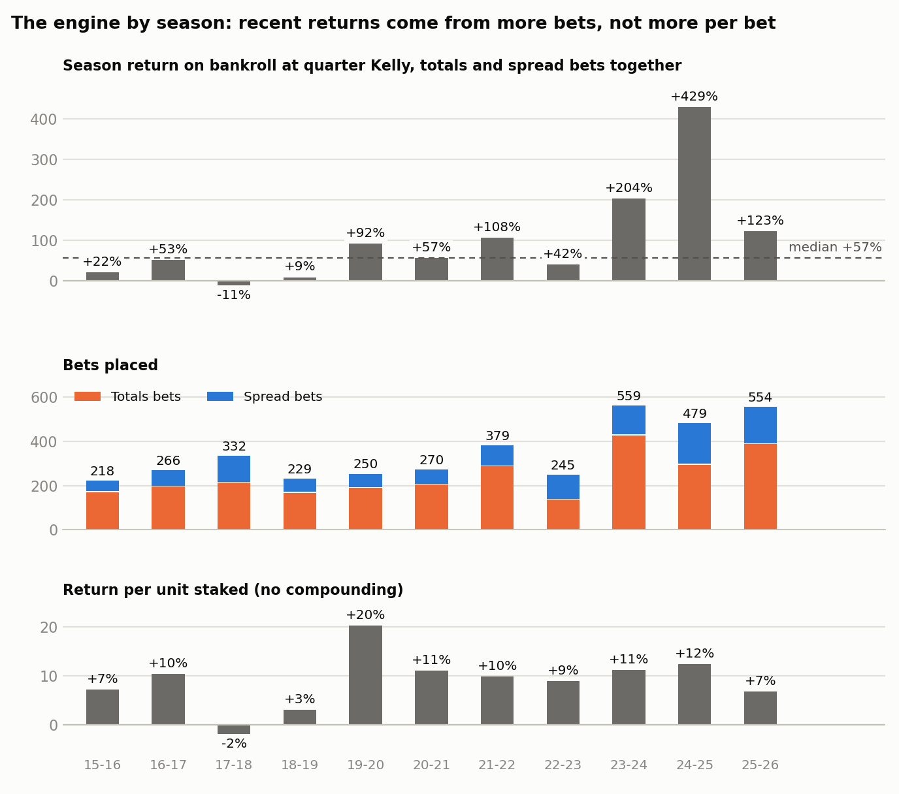

# NBA Prediction Model

A market-anchored NBA model for spreads and totals, with the full research record behind it. It does not out-forecast the market on average. It finds the games where the opening line is most wrong.

## Results

| | |
|---|---|
| **+54%** | Median season return of the full betting engine at quarter Kelly, over 11 seasons it had not seen. No losing season. |
| **56.7%** | Share of the engine's bets won, against a 52.4% break-even. About +10% return per unit staked on 314 bets a season. |
| **57.4%** | Spread rule: bets won when the model is 2+ points from the opening spread. 800 bets, 2012-26. |
| **55.6%** | Totals rule: bets won when the model is 2+ points from the opening total. 2,449 bets, above break-even in 12 of 14 seasons, and 55.8% on five seasons it was never tuned on. |
| **28-17** | Totals rule this season at the opening total, through 2026-11-15. |

These are backtests and replays that assume the opening line is bet. That has not been shown live: at the prices seen later in the day the edge disappears. No capital has been deployed.

## Pages

| Page | What it covers |
|---|---|
| [Betting engine](docs/ENGINE.md) | Every rule combined, each season bet with rules learned from earlier seasons |
| [Strategies](docs/STRATEGIES.md) | Each rule's results by month and by size of disagreement, with tested explanations |
| [2026-27 season](docs/SEASON_2026_27.md) | This season out of sample: log loss against the market, every bet type, the live book |
| [Model overview](docs/OVERVIEW.md) | What the model is, data limits, the 2019-26 record, how to run it |
| [Three-page review (PDF)](nba_model_and_strategy_review.pdf) | Summary of the system and its limits |
| [Decision register](docs/DECISIONS.md) | Every decision and rejection, in order |
| [Limitations](docs/LIMITATIONS.md) | What the results do not show |

## Status

Two paper views record the opening price, the price actually available, and the close for every spread and total. They began on 2026-11-16 and will be read at 40 spread bets and 60 totals bets.

## Licence & disclaimer

For research and educational purposes. Nothing here is betting advice, and the project's own conclusion is that nothing in it is statistically resolved.
