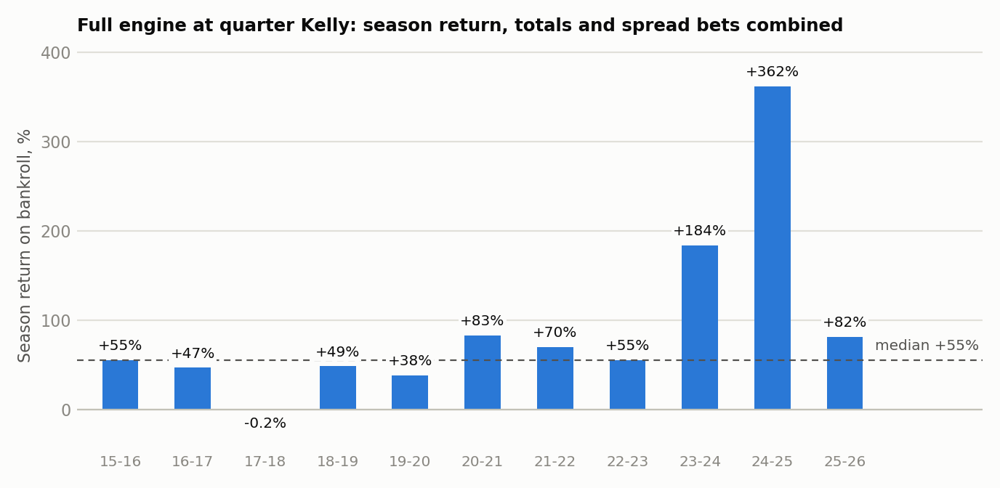
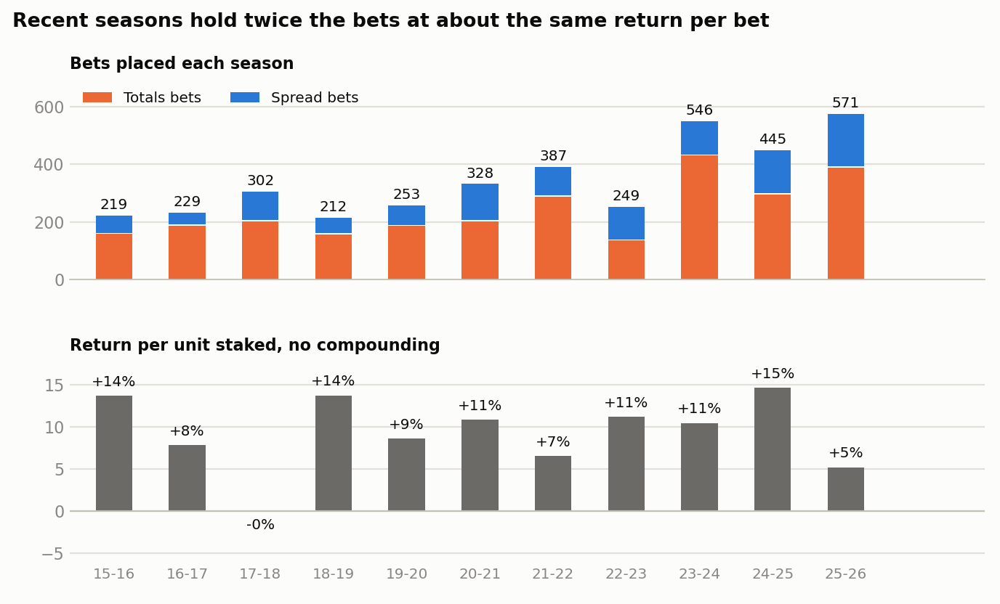

# The betting engine

This page asks what happens when every rule on the [strategies page](STRATEGIES.md) is used at once. The engine bets by size of disagreement, by time of season and by side, and sizes each stake to the estimated edge. Each season is bet with rules learned from earlier seasons.

Per unit staked the engine returns about +9%, and between 0% and +15% in every one of the 11 seasons. Compounded at quarter Kelly that is a median season of +55% of bankroll; ten seasons are profitable and the other finishes flat, at -0.2%. The season returns are the same edge multiplied by stake size, and all of it assumes the opening line can be bet.

## How it works

The candidates are the 6,404 games from 2012-13 to 2025-26 where the spread model or the totals model is 1.5 or more points from the opening line. Each model's prediction for a season comes from a fit on earlier seasons, and that includes the weights that combine the spread model's five pieces, which are refitted before each season on the seasons before it ([how the pieces are weighted](STRATEGIES.md#how-the-pieces-are-weighted)). The spread model knows who is expected to play from the injury-report feed where one exists (December 2018 on) and from a synthetic feed built from box scores before that; the [strategies page](STRATEGIES.md#knowing-who-plays) shows what each is worth.

For each test season, a regression is fitted on the candidates of earlier seasons. It estimates whether a bet wins from the size of the gap, the market, the part of the season and the side taken. The stake is a quarter of the Kelly stake that probability implies. There is no bet at or below break-even, and no more than 25% of the bankroll is at risk on one night.

The test seasons are 2015-16 to 2025-26, and nothing from a test season is used to bet it.

## Results at quarter Kelly

| Engine | Median season | Worst season | Largest drawdown | ROI per unit staked | Bets per season |
|---|---|---|---|---|---|
| Gap size only | +40.6% | -1.2% | 30% | +9.7% | 410 |
| + time of season | +61.8% | -1.2% | 33% | +8.7% | 352 |
| + side | +47.3% | +5.9% | 30% | +10.5% | 369 |
| All rules | +55.3% | -0.2% | 31% | +9.4% | 340 |

The seasonal rules beat the gap-only engine in 7 of 11 seasons, and all rules together beat it in 8. The means sit well above the medians because 2023-24 and 2024-25 were large: the all-rules mean is +93.2%, and without 2024-25 the mean is +66.3% and the median +55.2%.

Larger stakes raise both the return and the risk. At half Kelly the all-rules median is +117% with a 54% drawdown. At full Kelly it is +234%, with a 73% drawdown and a worst season of -57%.

| Season | Bets | Cover | ROI per unit staked | Season return | Largest drawdown |
|---|---|---|---|---|---|
| 2015-16 | 219 | 59.4% | +13.7% | +55.3% | 14% |
| 2016-17 | 229 | 56.3% | +7.9% | +46.9% | 13% |
| 2017-18 | 302 | 50.3% | 0.0% | -0.2% | 21% |
| 2018-19 | 212 | 58.5% | +13.8% | +48.5% | 21% |
| 2019-20 | 253 | 53.8% | +8.7% | +38.4% | 29% |
| 2020-21 | 328 | 58.2% | +10.9% | +82.8% | 13% |
| 2021-22 | 387 | 57.6% | +6.5% | +70.1% | 31% |
| 2022-23 | 249 | 57.8% | +11.2% | +55.2% | 19% |
| 2023-24 | 546 | 53.8% | +10.5% | +184.2% | 20% |
| 2024-25 | 445 | 58.4% | +14.7% | +362.1% | 20% |
| 2025-26 | 571 | 55.3% | +5.2% | +81.8% | 27% |

## Why recent seasons are larger

The two largest returns are 2023-24 and 2024-25, and in a backtest that deserves suspicion. An earlier version of this page had a real problem here: the spread model's pieces were combined as they had been designed on 2021-22 to 2025-26, and the spread rule covered 60.2% in those seasons against 56.2% before. The pieces are now weighted from earlier seasons only, and that gap is gone, with the rule covering 55.7% from 2021-22 on and 57.1% in the nine seasons before. What still carries hindsight is the choice of the pieces themselves, which was made with recent seasons in view. The totals model was specified in November 2026 before its results were looked at.

What is left is volume, not a higher return per bet: per unit staked, 2023-24 earned 10.5% and 2024-25 14.7%, against 13.7% in 2015-16 and 13.8% in 2018-19.

The engine placed 521 bets a season from 2023-24 on, against 272 before, as opening totals began to sit further from the model, at about the same stake on each (2.0% of the bankroll against 1.8%). Total stakes over a season therefore rose from roughly five times the bankroll to about ten, and because each stake is a share of the current bankroll, the same edge compounds into a far larger season. The stake sizes are also why these figures should not be read as achievable: opening lines carry low limits, and nobody gets ten times their bankroll down on them in a season.

Profit per bet barely changed. Across the two flat-stake rules, bets covered 55.7% for +6.4% per bet up to 2022-23 and 55.2% for +5.4% from 2023-24 on, while the number of bets a season went from 182 to 393, most of the increase in totals. Two checks rule out the obvious objections. Rerunning the totals model on opening lines from a second source gives the same volume and a 55.4% cover rate, so the extra bets are not a quirk of one data feed; and a totals model fitted on 2007-17 and never updated still covers 56.1% in 2023-26, on 227 bets a season against 157 before, so they are not a fit to recent seasons either. The volume is still the part least likely to carry over: so far this season 11% of totals reach the 2-point threshold at the line actually on screen, against 25% in the backtest's recent seasons.

## A repair to the 2024-25 opening lines

The opening lines for 2024-25 come from a single book, read through ESPN's odds feed. In October and November 2024 the feed's opening field often held an alternate line instead of the main one, and the price attached to it gives this away: a main line opens near -110 on both sides, while these opened anywhere from -450 to +290. By that test 40% of the opening totals and 21% of the opening spreads in those two months were not the main line, against under 1% from December on and none in 2025-26.

A model sides against a line that is 7 points off and usually wins, so left alone those games would have made 2024-25 look several times better than it was. Each one (121 totals and 70 spreads) was replaced with the opening line from a second source, Action Network, which sits within about a point of ESPN's on ordinary games, and the few with no second opener were left out. The models were then refitted season by season on the repaired lines, and the figures on this page and the strategies page come from that rerun.

## What it learned

Fitted on all seasons, the engine assigns these win rates to typical bets.

| Bet | Win rate | Bet? |
|---|---|---|
| Totals over, gap 2, Dec-Jan | 54.4% | Yes |
| Totals over, gap 2, Oct-Nov | 50.3% | No |
| Totals under, gap 2, Dec-Jan | 57.5% | Yes |
| Totals over, gap 4, Dec-Jan | 60.4% | Yes |
| Spread, gap 2, Oct-Nov | 56.1% | Yes |
| Spread, gap 3, Oct-Nov | 59.7% | Yes |
| Spread, gap 2, April | 54.1% | Yes |

These are the patterns on the strategies page, except that here each was learned from earlier seasons and then applied to the next one.

## A simpler engine

The simpler engine groups bets by market and gap size. It estimates each group's win rate from earlier seasons, pulls that estimate strongly toward break-even, and bets the groups that still clear it. It stakes less and places 193 bets a season.

| | Median season | Mean | Volatility (sd) | Worst | Losing seasons | ROI per unit staked |
|---|---|---|---|---|---|---|
| Totals + spread | +12.0% | +26.8% | 33.6% | -9.9% | 1 of 11 | +10.5% |
| Totals only | +9.0% | +19.8% | 26.7% | -3.1% | 2 of 11 | +9.8% |
| Spread only | +3.5% | +5.3% | 10.5% | -6.9% | 3 of 11 | +9.5% |

## Where the +55% comes from

The figure is leverage, not extra skill: ROI per unit staked is about +9% in the full engine and +10.5% in the simple one. The full engine returns more because it places 340 bets a season at larger stakes. Adding the seasonal and side rules does not improve the win-probability forecast itself, whose log loss goes from 0.68735 to 0.68755.

More bets did not mean more profit per bet. Bets per season more than doubled after 2022, as opening totals began moving more and the lower-gap groups, which win about 54%, came into play.

The figure also assumes every opening line is bet at -110 with 2 to 4% of the bankroll. First lines carry low limits, and most of their move toward the close happens overnight and on game day.

The engine is not safe from a bad year. In 2017-18 it won 50.3% of its bets, earned nothing per unit staked and finished down 0.2% after a 21% drawdown; the gap-only and seasonal versions each lost 1.2% that season, and the simpler engine lost 9.9%.

None of this has been shown live; the paper views began recording the price actually available on 2026-11-16.
