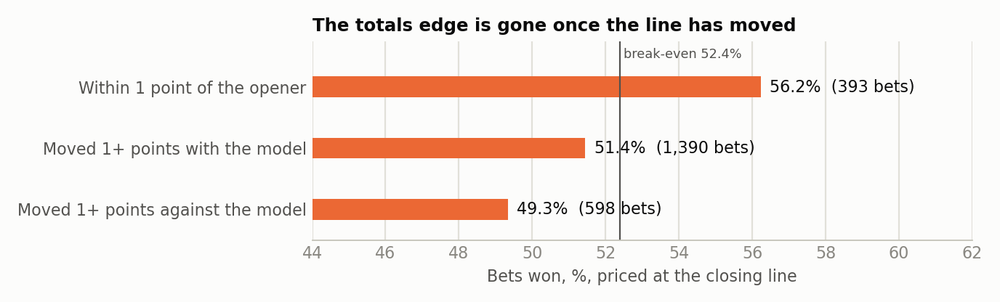

# Betting strategies

This page lists every strategy tried on top of the model, what it returned, and why. Each explanation comes with the number that backs it, and the headings say where one is partial or missing. Where a plausible story failed its check, it appears under rejected.

Unless stated, results are the walk-forward backtest for 2012-13 to 2025-26. Each season is scored by a model fitted on earlier seasons, bets are priced at the opening line at -110, and stakes are flat. This season's results are in [SEASON_2026_27.md](SEASON_2026_27.md).

## ROI and cover rate

ROI is per bet: it is profit divided by the amount staked, so +6% means each 1-unit bet returned 0.06 units on average. The return over a season then depends on how much is staked: ROI times the number of bets times the stake size. The totals rule earns +4.1% over about 147 bets, which at 1% of the starting bankroll per bet comes to 0.041 x 147 x 1%, or about +6% of bankroll.

Cover rate is the share of bets won, and at -110 the break-even is 52.4%.

Everything here assumes the opening line is actually bet, which has not been shown live.

## Summary

| Strategy | Bets per season | Cover | ROI per bet | Season return at 1% stakes | Status |
|---|---|---|---|---|---|
| Spread, model gap 2+ points | 58 | 56.3% | +7.4% | +4.3% | Backtest only |
| Totals, model gap 2+ points | 147 | 54.5% | +4.1% | +6.1% | Passed a pre-declared test |
| Totals, model gap 3+ points | 37 | 61.5% | +17.4% | +6.5% | Backtest only; the cut was made after the results |
| Totals, gap 2+ rule on 2007-12 (never tuned on) | 109 | 53.8% | +2.6% | +2.9% | Holdout |
| Totals, bet only within 1 point of the opener | about 120 | about 54.5% | about +4% | about +5% | Under live test |
| Either rule, stake in proportion to the gap | same bets | same | +8.3% spread, +6.0% totals | +6.2%, +12.1% | Logged beside the flat stake |
| Moneyline, four rules frozen before the season | about 75 | not comparable | no line value | not estimated | Live; likely no edge |
| Player points | not a rule yet | 52.6% at a 5+ point probability gap | +0.7% | not estimated | Not bettable |

The gap is how far the model's number sits from the line, in points.

Every weight behind these figures was learned from seasons before the one being scored. An earlier version of this page combined the spread model's pieces as they had been designed on 2021-22 to 2025-26, which flattered those seasons (60.2% against 56.2% before); with the weights learned walk-forward the rule covers 58.0% on 426 bets in 2012-21 and 54.4% on 388 since, and [how the pieces are weighted](#how-the-pieces-are-weighted) has the detail. The totals model was specified before its results were looked at.

The 2024-25 opening lines behind these figures were repaired after a fault in the source feed, which the [engine page](ENGINE.md#a-repair-to-the-2024-25-opening-lines) describes. Opening totals are missing for the second half of 2022-23, after their source stopped on January 16, 2023, so the totals rule covers 658 of that season's 1,230 games.

All of the rules combined into one engine, tested on seasons it had not seen, are on a separate page: [ENGINE.md](ENGINE.md).

## Priced the evening before

The opening line for a game is posted the evening before it, while that night's games are still being played, so a bet at the opener cannot know how those games went. Both models are now scored that way, with ratings, recent form and the totals model's inputs all stopping one night earlier. Until November 26 the backtest let them see the previous night's results, and removing that took the totals rule from 55.3% on 2,380 bets to 54.5% on 2,057 and the spread rule from 56.9% on 829 to 56.3% on 814.

Nearly all of the totals loss sits in games where one of the teams had played the night before: there the rule fell from 55.5% to 52.6%, while in the other games it stayed at 55%. The live views were never affected, because they can only use what is in the database when they look, and their coefficients were left as frozen.

## Spread rule

The rule bets the model's side when its corrected margin is 2 or more points from the opening spread.

### Where the edge comes from

Across 15,911 games the final margin moves 0.37 points for every point the model disagrees with the opener. A plain ratings model built from results in 20 lines of code earns 0.09, and it adds nothing once the full model is included. The player ratings, minutes and availability inputs are therefore doing the work.

### Bigger gaps cover more

A gap of a given size, set against an outcome spread of 12.6 points, implies a cover rate, and actual results follow it loosely: the two lower bands fall one to four points short and the top band matches.

| Gap | Implied by the model | Actual | Bets |
|---|---|---|---|
| 2 to 2.5 | 57.0% | 55.6% | 493 |
| 2.5 to 3 | 58.5% | 54.6% | 185 |
| 3+ | 61.5% | 61.0% | 136 |

### By month

| Month | Cover | Bets |
|---|---|---|
| Oct-Nov | 59.4% | 212 |
| Dec | 55.2% | 87 |
| Jan | 61.3% | 93 |
| Feb | 50.6% | 87 |
| Mar | 57.9% | 171 |
| Apr | 50.7% | 142 |

### Best in October and November

The model is no more accurate per point early in the season. It earns 0.34 points of result per point of gap in October and November, against 0.42 from December to March. What changes is how far it disagrees with the opener: the spread of that disagreement is 2.9 points early and 2.6 later. As a result 5.7% of early games reach the 2-point threshold, compared with 3.8% later, and they clear it by more.

### April loses

April is where the model disagrees with the opener most, at 3.4 points, and is right least, at 0.25 points of result per point of gap, and its bets cover 50.7%, which is below break-even. April games also carry more expected absences, 2.7 a game against 1.9, and on 2019-26 the April bets in games with three or more expected absences covered 47.7% (44 bets) against 53.3% for the rest (30 bets). That points at absences, but on samples far too small to settle it, and the same split pointed the other way on an earlier build of the model. April stays a known weak month without an explanation.

## Totals rule

The rule bets over or under when the model's predicted final total is 2 or more points from the opening total. This model uses no player data; it reads how the market has been pricing the two teams and the league.

### What drives the bets

Each bet was assigned to the input that contributed most to it.

| Largest contributor | Cover | Bets |
|---|---|---|
| Each team's previous game went over or under its closing total | 60.0% | 275 |
| Opening total differs from where recent closing totals put these teams | 55.0% | 1,121 |
| Each team's last five games ran over or under | 54.4% | 237 |
| League-wide totals have been running over or under | 51.2% | 172 |
| Days of rest | 50.2% | 231 |

Most bets come from an opener that sits away from where the market itself has recently closed these teams, while bets driven mainly by rest, or by the league-wide drift, do not pay.

### Bigger gaps cover more

The implied rates use an outcome spread of 18 points.

| Gap | Implied by the model | Actual | Bets |
|---|---|---|---|
| 2 to 3 | 55.3% | 52.2% | 1,535 |
| 3 to 4 | 57.4% | 59.7% | 392 |
| 4+ | 60.3% | 66.9% | 130 |

The 2 to 3 band sits at break-even, so the rule's profit comes from gaps of 3 or more, which cover 61.5% on 522 bets and were above break-even in all 14 seasons. On the 2007-12 holdout the same cut covers 58.6%, on only 87 bets.

### The edge dies when the line moves

Priced at the close, the bets covered 54.9% when the line stayed within 1 point of the opener. Once the line had moved with the model they covered 52.0%, and once it had moved against the model, 48.1%. The market corrects an opener within hours, sometimes minutes, so a late bet goes into a line that already holds what the model knows.

### By month

| Month | 2012-26 | Bets | 2007-12 holdout | Bets |
|---|---|---|---|---|
| Oct-Nov | 49.3% | 592 | 50.0% | 158 |
| Dec | 57.8% | 332 | 52.2% | 69 |
| Jan | 53.6% | 267 | 50.0% | 72 |
| Feb | 57.8% | 244 | 64.9% | 97 |
| Mar | 52.8% | 335 | 52.2% | 90 |
| Apr | 60.0% | 260 | 54.2% | 59 |

### April is strong (partly explained)

April games finish 2.1 points above the opening total on average, against 0.4 in other months. Of the model's 260 April bets, 251 were overs. The model leans to the over by about half a point and follows the league when totals run high, which puts it on the right side. Why April scoring beats the opener was not tested.

### Weak in October and November (unexplained)

One story is that the model has too little history early, but it holds only in part. Bets placed before team ratings existed covered 48.1% (129 bets), but bets placed with ratings available still covered only 49.7% (463 bets).

### February (unexplained)

February is strong in both samples, and the All-Star break is not the reason, since February bets on long-rested teams covered 54.8% and the others 59.4%.

## Sizing and thresholds

Staking in proportion to the gap (1 unit at 2 points, capped at 2.5) raises ROI from +7.4% to +8.3% on spreads and from +4.1% to +6.0% on totals. This follows from the gap tables above, because bigger gaps cover more. It trims the losing seasons from 2 of 14 to 1 on spreads and from 3 to 1 on totals.

A higher threshold gives more per bet and less in total. Spread bets at a gap of 2.5+ cover 57.3% for +9.4%, on 23 bets a season. Totals bets at 3+ cover 61.5% for +17.4%, on 37 a season.

On the totals rule, quarter Kelly returned +6.2% a season on average, with a median of +6.7% and a standard deviation of 10.4%. Full Kelly reached a 71% drawdown; the detail is in [SEASON_2026_27.md](SEASON_2026_27.md).

The monthly tables suggest spreads through November and totals from December. Those cuts were made after seeing the results, so this is a hypothesis for next season.

### How big a stake

The table runs both rules together with sized stakes, where the base stake is a share of the current bankroll and each of the 14 seasons starts fresh. No more than 25% of the bankroll is at risk on one night.

| Base stake | Median season | Worst season | Losing seasons | Worst drawdown within a season |
|---|---|---|---|---|
| 1% | +16.5% | -5.1% | 1 of 14 | 23% |
| 2% | +30.7% | -16.2% | 2 of 14 | 42% |
| 3% | +36.6% | -26.0% | 2 of 14 | 56% |
| 5% | +46.9% | -51.5% | 3 of 14 | 74% |
| 8% | +43.1% | -74.0% | 3 of 14 | 87% |

Drawdown grows almost in step with the stake, and the median return stops growing long before the drawdown does: it peaks at the 5% row, and at a 12% base stake it is +21.5%, with a 93% drawdown and five losing seasons. The longest losing run was 9 bets, and the busiest night carried 17 bets at once. Mean returns run far above the medians at the larger stakes, because a few seasons compound to several times the bankroll, which is why the table leaves them out.

## Why the rules win

The working thesis is that the model is faster than the opening line and no smarter than the market. On spreads it prices at the opener what the market prices over the following day, which is who will play and how good they are, and the line then moves toward it. The totals model uses no player data and bets when the opener sits away from where the market itself recently closed those teams. Neither rule has an edge at later prices, and the model does not beat the closing line on any market.

### Knowing who plays

The spread model is built on player ratings, so it matters how much it knows about who will play. The table reruns the same model over the same games with five levels of that knowledge, with its pieces weighted as everywhere else on this page, on the rule the live view uses: bet when the market-blind model is 5 or more points from the opening spread.

| What the model knows about who plays | 2012-18 cover | 2018-26 cover | All 14 seasons | Bets |
|---|---|---|---|---|
| Nothing | 55.8% | 53.2% | 54.0% | 1,226 |
| A synthetic feed built from box scores | 55.5% | 54.9% | 55.1% | 1,177 |
| The injury-report feed, as of the open | not available | 55.7% | 55.8% | 1,146 |
| Official inactive lists, 30 minutes before tip | 56.9% | 57.7% | 57.4% | 1,116 |
| Perfect hindsight | 60.3% | 58.4% | 59.0% | 1,140 |

Over the 14 seasons cover rises with every step, and so does the amount by which the bets beat the closing line, from 0.5 points with nothing to 1.9 with hindsight. The one step that does not show in cover is the synthetic feed in the earlier seasons, which adds line value there (0.4 points against 0.3) without adding wins. The injury-report feed only exists from December 2018, so for earlier seasons the backtest uses the synthetic feed, which estimates each rotation player's chance of sitting from box scores before game day: whether he missed the last game, how many in a row, days since he played, his minutes and back-to-backs. It recovers about two-thirds of what the real feed adds in the seasons that have both, and its estimate of minutes missing per team tracks reality about as well (a correlation of 0.66 against 0.72). The last two rows cannot be bet a day ahead and are there as a ceiling.

With the same information the two periods sit within a point or two of each other in every row except the first, and neither is consistently ahead.

### How the pieces are weighted

The market-blind spread model is the sum of five pieces: a team-strength estimate from the four factors, a second one from player ratings and expected minutes, a schedule term for home court and back-to-backs, a late-season tanking term, and an absence adjustment that charges about half a point for each expected absence beyond the missing player's own rating. A sixth piece, built on recent form late in the season, is switched off: it helped on the seasons it was developed on and did nothing on the two it had not seen. As first built the pieces were simply added, the tanking term was switched on only from 2020-21, and the whole arrangement was designed on 2021-22 to 2025-26. That flattered those seasons, and nearly all of the flattery came from the tanking term.

The backtest on this page now gives each piece a weight, refitted before every season by a regression of the final margin on the five pieces over all earlier seasons, and it switches the tanking term on throughout. Six numbers are tuned in all, the five weights and a constant, and none of them has seen the season it scores. The weights hold steady from year to year: 0.6 to 0.7 on the four-factor piece, 1.1 to 1.2 on the player piece, 0.9 to 1.0 on schedule, 0.8 to 1.2 on tanking after its first year, and 0.5 rising to 0.8 on the absence adjustment.

| Spread rule, gap 2+ | 2012-21 | 2021-26 | All 14 seasons |
|---|---|---|---|
| As first built, designed on 2021-26 | 56.2% | 60.2% | 58.3% |
| Weights learned from earlier seasons (this page) | 58.0% | 54.4% | 56.3% |

Walk-forward was chosen on principle, and then checked against 1,375 other ways of picking the tuning seasons: random samples of a third, a half, two-thirds or all of the seasons before each of ten cutoff years, with recent seasons weighted more, less or equally. The spread rule covered 55.7% on average across them, with nine in ten between 53.9% and 57.6% and all but a handful above break-even, and no cutoff, sample size or weighting moved the average by more than about a point. The walk-forward version on this page sits inside that range, above about three-quarters of them, whereas the model as first built sat above nearly all of them, which is what a design fitted to its own test seasons looks like. Weighting recent seasons more heavily, or fitting on only the last five or eight, left the forecast error unchanged at 12.94 points and moved the results in no consistent direction, so the plain version was kept.

### Not roster or league change

A model built on player ratings might be expected to win most when rosters change, since a market anchored on last season's results would be slow to adjust. That is not what the backtest shows. Turnover here is the share of a team's minutes so far played by players who were not on that team last season, which counts rookies and trades alike, and the table splits games into thirds by the two teams' combined turnover.

| Combined turnover | Spread cover | Bets | Totals cover | Bets |
|---|---|---|---|---|
| Low | 56.9% | 248 | 53.1% | 752 |
| Middle | 55.6% | 293 | 53.5% | 729 |
| High | 56.4% | 273 | 57.8% | 576 |

In a regression of win on gap, turnover and early season, the turnover coefficient is about zero for both rules (p = 0.80 on spreads and 0.41 on totals). The model's disagreement with the opener is also no wider when turnover is high. The early-season spread edge does not come from new rosters either, since October and November bets covered 64.8% in low-turnover games (71 bets) and 62.5% in high-turnover games (72 bets). Backing the team that was worse last season covered 55.6% (385 bets), against 56.8% for backing the better one (428 bets).

Season by season the picture is the same. Spread cover is uncorrelated with league-wide turnover (+0.24, on 14 seasons) and with the year-on-year change in league scoring (+0.12), and totals cover is no different (+0.13 and -0.11).

### Not periods of change either

The same question was asked of the stretches when rosters shift during a season, and of the particular teams that changed.

| Cut | Spread cover | Bets | Totals cover | Bets |
|---|---|---|---|---|
| Rotation stable over the last 15 games | 62.3% | 130 | 55.6% | 408 |
| Rotation churning | 52.5% | 299 | 57.9% | 610 |
| 28 days before the trade deadline | 62.5% | 72 | 54.6% | 205 |
| 21 days after the trade deadline | 47.5% | 99 | 61.1% | 226 |
| First 20 games, a rebuilt team in the game | 60.0% | 115 | 50.4% | 242 |
| First 20 games, no rebuilt team | 57.3% | 124 | 50.1% | 401 |
| 30 days after the deadline, a traded team in the game | 50.0% | 90 | 56.6% | 182 |
| 30 days after the deadline, no traded team | 50.8% | 59 | 59.5% | 116 |

Churn compares who played a team's last 5 games with the 10 before. A rebuilt team is in the top quarter for offseason turnover, and a traded team is one whose deadline arrivals went on to play 10% or more of its minutes. When rotations are churning the spread model fires on more games (6.7% against 2.9%) but is right less per point of gap (0.88 against 1.42), so cover falls instead of rising. The jump in totals cover after the deadline looked like a finding until it was run on the 2007-12 holdout, where it reversed to 60.0% before the deadline and 49.3% after.

One pattern points the other way and is recorded here as a lead. On spreads, bets where the model backs a rebuilt team covered 59.5% (168 bets), while bets where it fades one covered 51.6% (126 bets), and the same direction shows after the deadline and, more weakly, early in the season. The samples overlap, though, and a single test with no thresholds is positive without being significant (p = 0.21), so it waits for a season it was not found on.

If the edge came from understanding change it should rise with turnover, and it does not. What the bets have in common is a rough opening number: bet counts more than doubled from 2023, as opening totals began to sit further from the model.

## Tried and rejected

| Idea | Result |
|---|---|
| Train the spread model on line moves instead of final scores | Worse in 12 of 14 seasons |
| Trust the spread model more early in the season | Trust is the same early and late |
| Add rest and rookie minutes to the spread model | Better in only 6 of 14 seasons |
| Refit the spread model on recent seasons only | No gain |
| Bet against big line moves at the close | 48% |
| Bet with big line moves at the close | 51 to 52%, under break-even |
| Drop the totals model's standing lean to the over | Looked good on 2012-26 (56.8%), failed on 2007-12 (52.3%) |
| Totals bets relative to the season's running average call | No gain on 2007-12 (54.1% against 53.8%) |
| Add expected absences to the totals model | The opener already prices them |
| A different trust in the model by gap size, by month, or fixed at another value | None beats the fitted one third |

Two of these looked like improvements until they were run on seasons they had not been found on.

### Found on one sample, checked on another

Every rule and cut on this page was then put through the same check: its result on the sample it was found on, beside its result on games that played no part in finding it. For totals the fresh sample is 2007-12, for the spread model it is the seasons before the ones it was designed on, and for the monthly spread cuts, which were found on all 14 seasons, the two halves are set side by side.

| Rule or cut | Where it was found | Fresh sample |
|---|---|---|
| Totals rule, gap 2+ | 54.5% (2,057 bets), 2012-26 | 53.8% (545), 2007-12 |
| Totals, gap 3+ | 61.5% (522) | 58.6% (87) |
| Totals, unders | 56.9% (325) | 57.3% (117) |
| Totals from day 75 of the season | 57.3% (1,062) | 56.3% (279) |
| Totals in April | 60.0% (260) | 54.2% (59) |
| Totals in February | 57.8% (244) | 64.9% (97) |
| Totals, days 45 to 75 | 55.0% (302) | 42.3% (52) |
| Totals where the line then stayed within 1 point | 54.9% (344) | 45.8% (118) |
| Spread rule, gap 2+ | 54.4% (388), 2021-26, where the model was designed | 58.0% (426), 2012-21 |
| Spread rule in October and November | 62.5% (80), 2012-19 | 57.6% (132), 2019-26 |
| Spread rule in April | 51.5% (68), 2012-19 | 50.0% (74), 2019-26 |
| Spread rule in February | 69.2% (26), 2012-19 | 42.6% (61), 2019-26 |
| Day-before spread view, this season | 7-2 on the two weeks it was designed on | 4-8 in the three weeks since |

Across about thirty such comparisons one is significant at the 5% level, spreads in February, which is roughly what chance alone produces. The two headline rules, the larger-gap cuts, the under lean, the strong early spreads and the weak April all repeat. Three do not and should be read as unconfirmed: the mid-season totals stretch, totals where the line stays put, which is the cut the second live totals arm rests on, and this season's day-before spread view, whose first two weeks cannot count.

## Open questions

The first unknown is whether the opening line can be bet in practice, since both rules lose their edge at later prices. The second is whether any of this holds live, which the paper views began recording on 2026-11-16. The last three seasons hold far more bets than the earlier ones and supply the engine's largest returns, although at flat stakes they are the weaker seasons (53.4% against 56.0% before). One of them, 2024-25, accounts for 17% of the spread rule's profit on its own (58.1% on 93 bets); without it the rule covers 56.0% on 721 bets. Its rules were learned from earlier seasons and the result holds at two other sources of opening lines, but the choice of which rules to report was made with that season in view.
