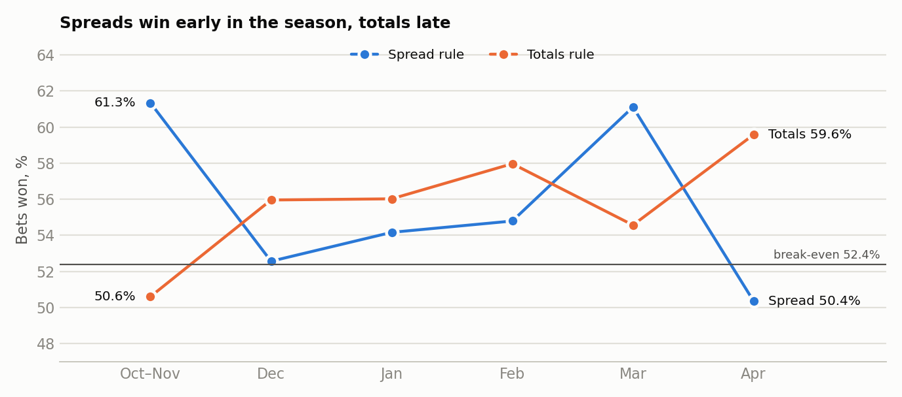

# Betting strategies

This page lists every strategy tried on top of the model, what it returned, and why. Each explanation comes with the number that backs it, and the headings say where one is partial or missing. Where a plausible story failed its check, it appears under rejected.

Unless stated, results are the walk-forward backtest for 2012-13 to 2025-26. Each season is scored by a model fitted on earlier seasons, bets are priced at the opening line at -110, and stakes are flat. This season's results are in [SEASON_2026_27.md](SEASON_2026_27.md).

## ROI and cover rate

ROI is per bet: it is profit divided by the amount staked, so +6% means each 1-unit bet returned 0.06 units on average. The return over a season then depends on how much is staked: ROI times the number of bets times the stake size. The totals rule earns +5.5% over about 170 bets, which at 1% of the starting bankroll per bet comes to 0.055 x 170 x 1%, or about +9.3% of bankroll.

Cover rate is the share of bets won, and at -110 the break-even is 52.4%.

Everything here assumes the opening line is actually bet, which has not been shown live.

## Summary

| Strategy | Bets per season | Cover | ROI per bet | Season return at 1% stakes | Status |
|---|---|---|---|---|---|
| Spread, model gap 2+ points | 54 | 56.8% | +8.4% | +4.5% | Backtest only |
| Totals, model gap 2+ points | 170 | 55.3% | +5.5% | +9.3% | Passed a pre-declared test |
| Totals, same rule on 2007-12 (never tuned on) | 137 | 57.4% | +9.5% | +13.0% | Holdout |
| Totals, bet only within 1 point of the opener | about 140 | about 55.3% | about +5.5% | about +8% | Under live test |
| Either rule, stake in proportion to the gap | same bets | same | +9.4% spread, +6.9% totals | +6.5%, +16.1% | Logged beside the flat stake |
| Moneyline, four rules frozen before the season | about 75 | not comparable | no line value | not estimated | Live; likely no edge |
| Player points | not a rule yet | 52.6% at a 5+ point probability gap | +0.7% | not estimated | Not bettable |

The gap is how far the model's number sits from the line, in points.

The 2024-25 opening lines behind these figures were repaired after a fault in the source feed, which the [engine page](ENGINE.md#a-repair-to-the-2024-25-opening-lines) describes.

All of the rules combined into one engine, tested on seasons it had not seen, are on a separate page: [ENGINE.md](ENGINE.md).

## Spread rule

The rule bets the model's side when its corrected margin is 2 or more points from the opening spread.

### Where the edge comes from

Across 15,911 games the final margin moves 0.33 points for every point the model disagrees with the opener. A plain ratings model built from results in 20 lines of code earns 0.09, and it adds nothing once the full model is included. The player ratings, minutes and availability inputs are therefore doing the work.

### Bigger gaps cover more

A gap of a given size, set against an outcome spread of 12.6 points, implies a cover rate, and actual results track it.

| Gap | Implied by the model | Actual | Bets |
|---|---|---|---|
| 2 to 2.5 | 56.9% | 54.7% | 450 |
| 2.5 to 3 | 58.5% | 59.9% | 162 |
| 3+ | 61.4% | 60.0% | 140 |

### By month

| Month | Cover | Bets |
|---|---|---|
| Oct-Nov | 61.3% | 238 |
| Dec | 52.6% | 78 |
| Jan | 54.2% | 72 |
| Feb | 54.8% | 73 |
| Mar | 61.1% | 126 |
| Apr | 50.4% | 141 |

### Best in October and November

The model is no more accurate per point early in the season. It earns 0.29 points of result per point of gap in October and November, against 0.40 from December to March. What changes is how far it disagrees with the opener: the spread of that disagreement is 3.1 points early and 2.5 later. As a result 6.4% of early games reach the 2-point threshold, compared with 3.0% later, and they clear it by more.

### April loses (small sample)

April is where the model disagrees with the opener most, at 3.5 points, and is right least, at 0.12 points of result per point of gap. April games also carry more expected absences: 2.7 a game against 1.9. On 2019-26, April bets in games with three or more expected absences covered 36.8% (38 bets), while the rest covered 61.3% (31 bets). The model is weakest when many regular players sit, although rest and tanking were not separated.

## Totals rule

The rule bets over or under when the model's predicted final total is 2 or more points from the opening total. This model uses no player data; it reads how the market has been pricing the two teams and the league.

### What drives the bets

Each bet was assigned to the input that contributed most to it.

| Largest contributor | Cover | Bets |
|---|---|---|
| Each team's previous game went over or under its closing total | 58.0% | 362 |
| Opening total differs from where recent closing totals put these teams | 55.7% | 1,272 |
| Each team's last five games ran over or under | 54.8% | 301 |
| League-wide totals have been running over or under | 54.3% | 186 |
| Days of rest | 51.3% | 238 |

Most bets, and most of the profit, come from an opener that sits away from where the market itself has recently closed these teams, while bets driven mainly by rest do not pay.

### Bigger gaps cover more

The implied rates use an outcome spread of 18 points.

| Gap | Implied by the model | Actual | Bets |
|---|---|---|---|
| 2 to 3 | 55.3% | 53.7% | 1,760 |
| 3 to 4 | 57.4% | 57.3% | 450 |
| 4+ | 60.4% | 65.9% | 170 |

### The edge dies when the line moves

Priced at the close, the bets covered 56.2% when the line stayed within 1 point of the opener. Once the line had moved with the model they covered 51.4%, and once it had moved against the model, 49.3%. The market corrects an opener within hours, sometimes minutes, so a late bet goes into a line that already holds what the model knows.

### By month

| Month | 2012-26 | Bets | 2007-12 holdout | Bets |
|---|---|---|---|---|
| Oct-Nov | 50.6% | 664 | 54.4% | 204 |
| Dec | 56.0% | 411 | 52.7% | 91 |
| Jan | 56.0% | 332 | 57.1% | 98 |
| Feb | 58.0% | 276 | 63.4% | 101 |
| Mar | 54.6% | 383 | 55.5% | 110 |
| Apr | 59.6% | 287 | 65.4% | 81 |

### April is strong (partly explained)

April games finish 2.1 points above the opening total on average, against 0.4 in other months. Of the model's 287 April bets, 277 were overs. The model leans to the over by about half a point and follows the league when totals run high, which puts it on the right side. Why April scoring beats the opener was not tested.

### Weak in October and November (unexplained)

One story is that the model has too little history early, but it holds only in part. Bets placed before team ratings existed covered 49.2% (124 bets), but bets placed with ratings available still covered only 50.9% (540 bets).

### February (unexplained)

February is strong in both samples, and the All-Star break is not the reason, since February bets on long-rested teams covered 56.6% and the others 58.5%.

## Sizing and thresholds

Staking in proportion to the gap (1 unit at 2 points, capped at 2.5) raises ROI from +8.4% to +9.4% on spreads and from +5.5% to +6.9% on totals. This follows from the gap tables above, because bigger gaps cover more. It does not smooth the seasons much: losing seasons go from 2 of 14 to 4 on spreads, two of them by under half a unit, and from 2 to 1 on totals.

A higher threshold gives more per bet and less in total. Spread bets at a gap of 2.5+ cover 59.9% for +14.4%, on 22 bets a season. Totals bets at 3+ cover 59.7% for +13.9%, on 44 a season.

On the totals rule, quarter Kelly returned +9.6% a season on average, with a median of +4.7% and a standard deviation of 14.0%. Full Kelly reached a 68% drawdown; the detail is in [SEASON_2026_27.md](SEASON_2026_27.md).

The monthly tables suggest spreads through November and totals from December. Those cuts were made after seeing the results, so this is a hypothesis for next season.

### How big a stake

The table runs both rules together with sized stakes, where the base stake is a share of the current bankroll and each of the 14 seasons starts fresh. No more than 25% of the bankroll is at risk on one night.

| Base stake | Median season | Worst season | Losing seasons | Worst drawdown within a season |
|---|---|---|---|---|
| 1% | +19.2% | -6.5% | 2 of 14 | 20% |
| 2% | +29.2% | -17.1% | 2 of 14 | 40% |
| 3% | +39.4% | -30.9% | 2 of 14 | 52% |
| 5% | +56.2% | -51.5% | 2 of 14 | 67% |
| 8% | +72.9% | -74.9% | 3 of 14 | 81% |

Drawdown grows almost in step with the stake, and the median return stops growing before the drawdown does: at a 12% base stake the median is +69.0%, below the 8% row, with a 93% drawdown and five losing seasons. The longest losing run was 12 bets, and the busiest night carried 18 bets at once. Mean returns run far above the medians at the larger stakes, because a few seasons compound to several times the bankroll, which is why the table leaves them out.

## Why the rules win

The working thesis is that the model is faster than the opening line and no smarter than the market. On spreads it prices at the opener what the market prices over the following day, which is who will play and how good they are, and the line then moves toward it. The totals model uses no player data and bets when the opener sits away from where the market itself recently closed those teams. Neither rule has an edge at later prices, and the model does not beat the closing line on any market.

### Not roster or league change

A model built on player ratings might be expected to win most when rosters change, since a market anchored on last season's results would be slow to adjust. That is not what the backtest shows. Turnover here is the share of a team's minutes so far played by players who were not on that team last season, which counts rookies and trades alike, and the table splits games into thirds by the two teams' combined turnover.

| Combined turnover | Spread cover | Bets | Totals cover | Bets |
|---|---|---|---|---|
| Low | 57.0% | 237 | 54.9% | 887 |
| Middle | 55.7% | 271 | 54.9% | 827 |
| High | 57.8% | 244 | 56.2% | 666 |

In a regression of win on gap, turnover and early season, the turnover coefficient is about zero for both rules (p = 0.88 on spreads and 0.73 on totals). The model's disagreement with the opener is also no wider when turnover is high. The early-season spread edge does not come from new rosters either, since October and November bets covered 63.2% in low-turnover games (87 bets) and 64.9% in high-turnover games (77 bets). Backing the team that was worse last season covered 58.0% (269 bets), against 56.0% for backing the better one (482 bets).

Season by season the picture is the same. Spread cover is uncorrelated with league-wide turnover (+0.01) and with the year-on-year change in league scoring (+0.04). Totals cover falls with league turnover (-0.56), which is most likely a shared time trend, because turnover has drifted down over the years in which totals bets have grown.

### Not periods of change either

The same question was asked of the stretches when rosters shift during a season, and of the particular teams that changed.

| Cut | Spread cover | Bets | Totals cover | Bets |
|---|---|---|---|---|
| Rotation stable over the last 15 games | 58.7% | 121 | 56.5% | 503 |
| Rotation churning | 54.3% | 245 | 57.1% | 694 |
| 28 days before the trade deadline | 58.2% | 55 | 53.1% | 254 |
| 21 days after the trade deadline | 54.1% | 74 | 61.8% | 254 |
| First 20 games, a rebuilt team in the game | 60.5% | 119 | 50.2% | 263 |
| First 20 games, no rebuilt team | 58.9% | 141 | 52.6% | 456 |
| 30 days after the deadline, a traded team in the game | 56.2% | 64 | 57.6% | 210 |
| 30 days after the deadline, no traded team | 61.0% | 41 | 61.1% | 131 |

Churn compares who played a team's last 5 games with the 10 before. A rebuilt team is in the top quarter for offseason turnover, and a traded team is one whose deadline arrivals went on to play 10% or more of its minutes. When rotations are churning the spread model fires on more games (5.5% against 2.7%) but is right less per point of gap (0.80 against 1.36), so cover does not improve. The jump in totals cover after the deadline looked like a finding until it was run on the 2007-12 holdout, where it reversed to 59.8% before the deadline and 50.6% after.

One pattern points the other way and is recorded here as a lead. On spreads, bets where the model backs a rebuilt team covered 58.7% (126 bets), while bets where it fades one covered 49.2% (124 bets), and the same gap appears early in the season and after the deadline. The samples overlap, though, and a single test with no thresholds is positive without being significant (p = 0.30), so it waits for a season it was not found on.

If the edge came from understanding change it should rise with turnover, and it does not. What the bets have in common is a rough opening number: bet counts more than doubled from 2023, as opening totals began to sit further from the model.

## Tried and rejected

| Idea | Result |
|---|---|
| Train the spread model on line moves instead of final scores | Worse in 11 of 14 seasons |
| Trust the spread model more early in the season | Trust is the same early and late |
| Add rest and rookie minutes to the spread model | Better in only 5 of 14 seasons |
| Refit the spread model on recent seasons only | No gain |
| Bet against big line moves at the close | 48% |
| Bet with big line moves at the close | 51 to 52%, under break-even |
| Drop the totals model's standing lean to the over | Looked good on 2012-26 (56.6%), failed on 2007-12 (51.7%) |
| Totals bets relative to the season's running average call | 54.2% against 57.4% on 2007-12 |
| Add expected absences to the totals model | The opener already prices them |
| Perfect knowledge of who plays, for spreads | 58.0% becomes 58.4% (measured before the opening-line repair) |

Two of these looked like improvements until they were run on seasons they had not been found on. The monthly and by-type cuts on this page have had no such check, so they only describe the backtest.

## Open questions

The first unknown is whether the opening line can be bet in practice, since both rules lose their edge at later prices. The second is whether any of this holds live, which the paper views began recording on 2026-11-16. The last three seasons also supply most of the backtest profit, because they hold far more bets than the earlier ones.
